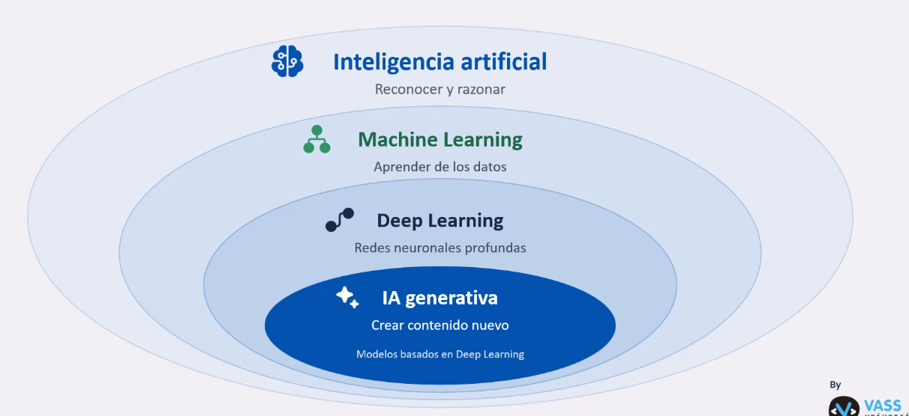

# Lab 1

La Inteligencia Artificial es la rama de la informática que busca reconocer y razonar (Nota del autor: Ahora se le dice IA a todo a modo de etiqueta comercial, realmente los modelos basados en IA son algoritmos para automatizar procesos, a mi me gusta a veces llamarlo: estadística al "trancazo").

Un modelo de IA aprende en la fase de entrenamiento, en la cuál, mediante algoritmos, o datos, el modelo detecta patrones que optimizan los parámetros del mismo. Una vez el modelo es entrenado, mediante métricas se evalúa su rendimiento.

Los modelos consisten en tres pilares:

- Datos
- Parámetros del modelo
- Resultados

Mediante los resultados que se obtienen del modelo en la fase de entrenamiento (usando los datos), los parámetros del modelo se optimizan en base a ciertas reglas (a los datos en el caso de aprendizaje supervisado, distintos algoritmos en el caso de no supervisado, entre otros).

Entre las distintas ramas de la IA se encuentran el Computer Vision, NLP, ML e IA generativa.

La calidad del modelo va a tener una conexión alta con la calidad de los datos: Representativos, limpios, sesgos, privacidad, etc...